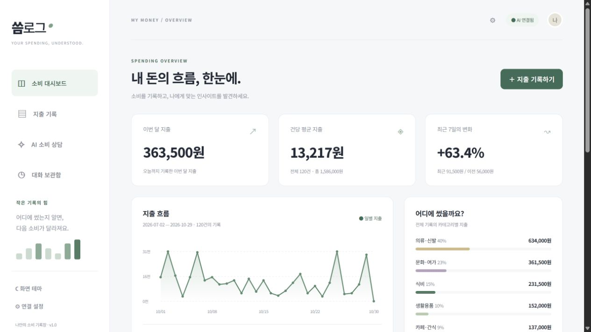

# 씀로그 — AI Expense Tracker

사진으로 지출을 기록하고 AI와 소비 패턴을 돌아보는 개인용 가계부입니다. 영수증·상품 사진을 분석한 뒤 사용자가 확인한 항목과 금액을 Firestore에 저장합니다. 카드사 자동 연결은 제공하지 않습니다.

## 배포된 앱

- **서비스:** [씀로그 열기](https://ai-expense-tracker-tau-sepia.vercel.app/)
- **API 문서:** [Swagger](https://ai-expense-tracker-tau-sepia.vercel.app/docs)
- **구성:** Vercel 한 프로젝트에서 화면과 FastAPI API를 함께 실행하고, 데이터는 Firebase Firestore에 보관합니다. Render는 현재 사용하지 않습니다.
- **사진 분석:** Codyssey의 Anthropic 호환 API + `claude-haiku-4`
- **소비 상담:** Codyssey의 OpenAI 호환 API + `gpt-5-mini`

배포 앱에는 시연용 가상 지출 120건을 추가했습니다. 각 항목은 `source=sample`과 시연 데이터 메모로 구분되며 실제 소비 기록이 아닙니다. 이후 사용자가 추가·수정·삭제하면 현재 건수는 달라질 수 있습니다.

## 접속 방법

1. 배포된 앱에서 **연결 설정(⚙)**을 엽니다.
2. API 서버 주소는 배포 주소 그대로 둡니다.
3. 앱 소유자가 전달한 **앱 접근 암호**를 입력하고 **연결하기**를 누릅니다.

접근 암호는 해당 탭의 세션에만 보관됩니다. 새 탭·다른 브라우저·다른 기기에서는 다시 입력해야 합니다. 암호가 없으면 화면은 열리지만 지출·상담 데이터 조회와 AI 호출은 차단됩니다. OpenAI·Anthropic API 키나 Firebase 키를 이 입력란에 넣지 않습니다.

개인용 단일 저장소 앱이므로 같은 접근 암호를 아는 사람은 같은 기록을 봅니다. 사용자별 로그인과 데이터 분리는 아직 없습니다.

## 기능

| 기능 | 동작 |
|---|---|
| 영수증 분석 | 날짜·가게·품목·분류·품목별 금액을 추출하고 확인 후 일괄 저장 |
| 상품 사진 분석 | 상품 하나의 이름·분류를 추출. 가격이 없거나 불명확하면 직접 입력 |
| 지출 관리 | 직접 입력, 수정, 삭제, 상품명·메모·가게명 검색, 카테고리 필터 |
| 대시보드 | 이번 달 지출, 건당 평균, 최근 7일 변화, 30일 일별 그래프, 카테고리별 합계 |
| 소비 상담 | 저장된 지출 요약을 바탕으로 답변하고 대화를 자동 저장 |
| 대화 보관함 | 대화 목록·불러오기·이어가기·삭제 |
| 기타 | 전체 지출 CSV 내보내기, 다크 모드, 모바일 화면, 처리 중·오류 안내 |

영수증의 품목 금액은 수량이 반영된 **줄 전체 금액**입니다. 최종 결제 총액은 검증에만 쓰며 지출로 중복 저장하지 않습니다. 항목 합계와 총액이 다르면 금액을 수정한 뒤 저장합니다. 자동 중복 영수증 제거는 구현하지 않았습니다.

## 실행 구조

```text
브라우저 ── HTTPS ── Vercel
                      ├─ HTML / CSS / JavaScript 화면
                      └─ FastAPI
                          ├─ 사진 → Anthropic 호환 API → 결과 검증
                          ├─ 질문 + 지출 요약 → OpenAI 호환 API
                          └─ Firebase Admin SDK → Firestore
```

사진 원본은 Firestore에 저장하지 않습니다. 분석 시 설정된 API 제공자에게 전송하고, 사용자가 확인한 텍스트·금액만 저장합니다.

```text
app.py                       Vercel 진입점
requirements.txt             Vercel 운영 의존성
vercel.json                  FastAPI 프리셋, 함수 제한, 응답 헤더
backend/
  main.py                    로컬 Uvicorn 진입점
  app/main.py                앱, CORS, 화면·정적 파일 제공
  app/routers.py             인증, API, 업로드 검증
  app/models.py              입력 및 AI 응답 스키마 검증
  app/services.py            통계, 사진 분석, 소비 상담
  app/store.py               Firestore / 로컬 JSON 저장
  tests/test_app.py          외부 API를 호출하지 않는 자동 테스트
  tests/manual_deployment_check.py  배포 앱 실연동 검증
frontend/
  index.html, style.css, app.js, config.js
  build.mjs                  분리 배포가 필요할 때 사용하는 정적 빌드
firestore.rules              브라우저 직접 DB 접근 차단
firestore.indexes.json        선택적 인덱스 제외 설정
```

Firestore 컬렉션은 `data/{id}`(지출 항목)와 `conversations/{id}`(대화)입니다. 필드와 통계 정의는 [Firestore 설계](docs/firestore-schema.md)를 참고하세요. 규칙·인덱스 파일은 저장소 설정 파일이며 Git push만으로 Firebase에 적용되지는 않습니다.

## 설계 근거

### 컨텍스트 주입의 이점과 위험

소비 상담은 모델의 일반 지식만으로 답하지 않도록 **서버가 계산한 지출 요약을 시스템 프롬프트에 주입**합니다. 구현은 [services.py의 `answer()`](backend/app/services.py)에 있습니다. `json.dumps(summary, ensure_ascii=False)`로 요약을 직렬화하고, 근거 없는 구매내역을 만들지 말라는 지시와 함께 시스템 메시지로 전달합니다. 이후 최근 대화 최대 20개를 덧붙여 답변을 요청합니다.

| 관점 | 기대 이점 | 위험·트레이드오프와 현재 대응 |
|---|---|---|
| 답변 근거 | 저장된 지출의 건수·합계·카테고리·기간별 추세를 바탕으로 사용자에게 맞는 답변을 만들 수 있음 | 모델이 수치를 잘못 해석하거나 근거 밖의 답변을 만들 가능성은 남음. 없는 구매내역을 만들지 않고 서로 다른 기간의 통계를 단순 비교하지 않도록 시스템 메시지로 제한함 |
| 보안·개인정보 | 개별 구매의 상품명·가게·메모를 포함한 전체 원본 대신 서버가 만든 통계를 전달하여 불필요한 정보 노출을 줄임 | 합계·날짜별 지출도 민감할 수 있으며, 최근 대화에는 사용자가 입력한 개인정보가 포함될 수 있음. 통계와 대화는 외부 AI 제공자에게 전송되므로 익명화나 완전한 비공개를 보장하지 않음. API 키·Firebase 인증 정보는 프롬프트에 넣지 않고 서버 인증에만 사용함 |
| 정보량·비용 | 원본 구매 항목 전체보다 중복 정보가 적고, 최근 대화 20개 제한으로 대화 입력량을 줄일 수 있음 | 특정 상품·가게·개별 결제의 상세 질문에는 정보가 부족함. 전체 기간의 일별 합계도 요약에 포함되므로 기록 기간이 길어지면 입력량이 증가함. 현재 별도 토큰 예산에 따른 요약 축소는 구현하지 않음 |
| 재현성·검증 | 같은 기록과 같은 기준일에는 같은 통계 함수를 사용하므로 화면의 수치와 AI에 제공한 수치를 비교할 수 있음 | 날짜가 바뀌거나 기록을 수정하면 요약도 바뀌며, 같은 프롬프트라도 모델 답변은 달라질 수 있음. 현재 대화 문서에는 메시지만 저장하고 주입한 요약·모델 버전의 스냅샷은 저장하지 않으므로 과거 답변을 완전히 재현할 수는 없음 |
| 프롬프트 인젝션 | 시스템 메시지에서 기록·메모는 지시가 아닌 데이터라고 명시하고, 역할을 서버에서 구성함 | 자연어 지시만으로 악의적인 입력을 완전히 차단할 수는 없음. 프롬프트에 비밀값을 넣지 않고, 입력 길이·메시지 역할 검증과 API 접근 암호를 함께 적용함 |

따라서 컨텍스트 주입은 **지출 요약을 근거로 소비를 설명하는 데 유리하지만**, 상세 내역 질문·개인정보 전송·답변 재현성에는 한계가 있습니다. 향후 과거 답변의 감사·재현이 필요하면 응답과 함께 요약 기준시각, 요약 스냅샷, 모델 식별자, 프롬프트 버전을 저장하는 방식으로 확장할 수 있습니다. 이는 현재 구현된 기능이 아닌 개선 방향입니다.

### 요약 API를 분리한 이유와 재사용 시나리오

`GET /api/data/summary`는 **지출을 숫자로 집계하는 책임을 화면 표시 및 AI 답변 생성과 분리**하기 위한 API입니다. [routers.py의 `summary()`](backend/app/routers.py)는 저장소에서 지출을 읽어 [services.py의 `summarize(rows)`](backend/app/services.py)를 호출합니다. 집계 규칙은 서비스 함수 한 곳에만 두고, 라우터는 인증된 HTTP 요청과 결과 응답을 연결합니다.

현재 두 소비자가 동일한 집계 로직을 재사용합니다.

```text
대시보드 → GET /api/data/summary → summarize(저장된 지출) → JSON → 통계·그래프 표시
AI 상담 → POST /api/chat → summary() → summarize(저장된 지출)
                                      → answer(대화, 요약) → 시스템 프롬프트 주입
```

- **책임 분리:** 통계 API는 숫자와 기간 정의를 반환하고, 프론트는 이를 표시하며, AI는 요약을 자연어로 설명합니다. 요약 API 자체는 AI를 호출하지 않으므로 통계 조회만으로 AI 사용료가 발생하지 않습니다.
- **재사용성과 일관성:** 대시보드와 상담에서 건당 평균·일평균·최근 7일 비교를 각각 다시 계산하지 않습니다. 계산 기준을 바꿀 때 `summarize()`를 수정하면 두 경로에 같은 변경이 반영됩니다. 다만 두 요청 사이에 기록이나 기준일이 바뀌면 조회 결과가 달라질 수 있습니다.
- **검증 용이성:** `/api/data/summary`의 실제 JSON을 구매 항목 합계와 비교하고, `summarize()`는 임시 데이터로 단위 테스트할 수 있습니다. AI 제공자나 모델을 바꿔도 통계 계산을 별도로 검증할 수 있습니다.
- **내부 호출 방식:** 상담 라우터는 자기 서버에 HTTP 요청을 보내지 않고 `summary()`를 직접 호출하여 같은 서비스 함수를 실행합니다. 불필요한 네트워크 왕복과 내부 HTTP 인증 처리를 피하며, 두 외부 API 경로 모두 `X-App-Token` 인증을 적용합니다.
- **확장 시나리오와 비용:** 향후 월별 리포트·예산 알림도 같은 집계 함수를 사용할 수 있습니다. 현재는 요청마다 전체 지출을 읽는 방식이라 Firestore 읽기 비용과 처리 시간이 기록 수에 따라 증가합니다. 데이터가 커지면 기간 필터, 캐시 또는 사전 집계가 필요합니다. 현재 월·최근 7일 기준은 고정이며 기간 파라미터화와 캐시는 구현하지 않았습니다.

## Vercel 배포 설정

이 저장소를 Vercel에 연결한 뒤 아래처럼 설정합니다.

| 항목 | 값 |
|---|---|
| Root Directory | 저장소 루트 `./` |
| Application Preset | FastAPI |
| 진입점 | 루트 `app.py` |
| 설정 파일 | 루트 `vercel.json` |
| API 서버 주소 | 화면과 같은 원점, `API_BASE_URL` 불필요 |

`frontend/`를 루트로 선택하면 화면만 배포되므로 현재 구성에서는 사용하지 않습니다. 루트 의존성은 `requirements.txt`에 직접 선언합니다. Vercel 프로젝트가 연결된 `main` 브랜치에 변경사항을 push하면 배포가 진행됩니다.

다음 값은 **Vercel 프로젝트의 Production 서버 전용 환경변수**로 설정합니다. 실제 값과 앱 접근 암호는 저장소에 포함하지 않습니다.

| 변수 | 용도 / 현재 구성 |
|---|---|
| `APP_MODE` | `production` |
| `STORAGE_MODE` | `firestore` |
| `APP_ACCESS_TOKEN` | 소유자만 아는 충분히 긴 앱 접근 암호 |
| `OPENAI_BASE_URL` | `https://copa.codyssey.kr/v1` |
| `OPENAI_MODEL` | `gpt-5-mini` |
| `OPENAI_API_KEY` | OpenAI 호환 상담용 키 |
| `VISION_PROVIDER` | `anthropic` |
| `VISION_MODEL` | `claude-haiku-4` |
| `ANTHROPIC_BASE_URL` | `https://copa.codyssey.kr` |
| `ANTHROPIC_API_KEY` | 사진 분석용 별도 Anthropic 호환 키 |
| `FIREBASE_PROJECT_ID` | 연결할 Firebase 프로젝트 ID |
| `FIREBASE_SERVICE_ACCOUNT_JSON` | Firebase 서비스 계정 JSON 전체 |

현재 키는 Production에만 저장되어 있습니다. Vercel 실행 시 운영 모드·Firestore·접근 암호가 빠져 있으면 서버가 시작되지 않도록 검사합니다. 프론트 공개 변수나 GitHub 코드에 비밀값을 넣지 않습니다. `.gitignore`와 `.vercelignore`가 환경 파일·서비스 계정·로컬 데이터를 제외합니다.

## 로컬 실행

Python 3.10 이상과 Node.js(프론트 문법 검사·분리 빌드 시)가 필요합니다.

```powershell
py -3 -m venv .venv
.venv/Scripts/python.exe -m pip install -r backend/requirements.txt
./start.ps1
```

[로컬 앱](http://127.0.0.1:8017)에서 확인합니다. 설정이 없는 기본 실행은 `demo` 모드로 로컬 JSON에 저장하며 사진 분석은 비활성화됩니다. 시연 상담은 실제 AI가 아닌 통계 기반 문구입니다. 빈 시연 저장소에서만 설정 화면의 시연 데이터 생성 버튼을 사용할 수 있습니다. 배포 운영 모드에서는 이 버튼의 API가 차단됩니다.

실제 AI를 로컬에서 쓰려면 `backend/.env`에 위 설정을 직접 작성합니다. 저장소에는 환경 파일 예시도 포함하지 않습니다. 로컬 저장을 원하면 `STORAGE_MODE=local`을 사용합니다. Firebase 서비스 계정 파일을 쓰는 경우 JSON 환경변수 대신 `GOOGLE_APPLICATION_CREDENTIALS`에 파일의 절대 경로를 지정합니다. JSON 저장소는 단일 프로세스용입니다.

## 검증

```powershell
.venv/Scripts/python.exe -m pytest backend/tests -q
node --check frontend/app.js
node --test frontend/tests/chat-input.test.mjs
# 선택: 분리 배포용 정적 빌드
Set-Location frontend
node build.mjs
```

자동 테스트 **13개**는 CRUD·입력 검증, 일괄 저장 원자성, 통계, 상담 저장·이어가기·삭제, 시연 데이터, 인증, 이미지 형식·용량, AI 응답 검증, Anthropic 요청 형식, 정적 파일 제공 등을 확인합니다. 자동 테스트는 임시 로컬 저장소와 모의 AI 응답을 사용합니다.

프론트 채팅 입력 테스트 **4개**는 전송 즉시 입력창 초기화, 중복 전송 방지, 대기 중 작성한 다음 질문 보존, 실패 시 원문 복원을 확인합니다.

**2026-10-30 최종 확인:** 자동 테스트 13개, 배포 실연동 검사 13개를 통과했습니다. 실제 화면에서도 직접 입력·수정, 검색·필터·빈 결과, CSV 파일의 한글·열 구성, 영수증 업로드·분석, 다크 모드 유지, 모바일 표시를 확인했습니다. 검증용 지출·상담은 삭제했고 기존 기록은 보존했습니다.

실제 배포 실연동 검증은 `python backend/tests/manual_deployment_check.py`로 실행합니다. 운영 접근 암호를 로컬의 Git 제외 파일 `.vercel/access-password.txt`에서 읽으며 실제 AI 사용량이 발생합니다. 검증용으로 생성한 지출·대화만 삭제하고 기존 기록은 보존합니다. 최근 실연동 결과는 [배포 검증 기록](docs/verification/deployment.json)에 남깁니다.

영수증·상품 분석용 가상 이미지와 결과는 [사진 분석 테스트](docs/vision-smoke/)에 있습니다. 합성 영수증의 정답은 아메리카노 9,000원 + 쿠키 3,200원 = 12,200원입니다. 가격 없는 상품은 금액을 추정하지 않고 비워야 합니다.

## 제한 사항

- 사진은 JPG·PNG·WEBP, **4MB(4 MiB) 이하**로 제한합니다. [Vercel 함수의 요청 한도](https://vercel.com/docs/functions/limitations#request-body-size) 안에서 multipart 요청을 처리하기 위한 설정입니다.
- 흐린 사진, 구겨진 영수증, 할인·수량·약칭, 복수 상품 사진은 오인식할 수 있습니다. 저장 전 결과 확인이 필요합니다.
- 검증용 합성 이미지의 성공은 모든 실제 촬영 사진에서의 정확도를 보장하지 않습니다.
- AI 상담에는 전체 지출 요약과 최근 대화 20개를 전달합니다. 개별 구매내역 전체는 전달하지 않습니다.
- 건당 평균은 항목 수 기준입니다. 일평균은 첫 기록~마지막 기록 사이의 무기록일을 0원으로 포함합니다. 추세는 한국 시간 기준 최근 7일과 직전 7일을 비교합니다.
- 사진 분석 출력은 최대 3,000토큰, 상담은 700토큰입니다. 프로세스별 분당 10회 제한은 서버리스 인스턴스 전체의 통합 한도는 아닙니다.
- 삭제 복구, 자동 영수증 중복 제거, 사용자별 로그인·데이터 격리는 아직 없습니다.

## 화면 예시

아래는 2026-10-30 배포 앱에서 확인한 가상 데이터 기반 화면입니다. 실제 소비 내역이 아닙니다.



[영수증 분석 화면](docs/verification/receipt-ui.png) · [모바일 화면](docs/verification/mobile-ui.png) · [화면 검증 결과](docs/verification/ui.json)
